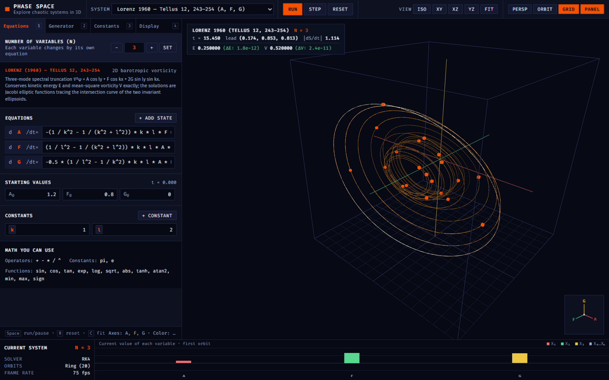

<p align="center">
  
</p>

<h1 align="center">Phase Space</h1>

<p align="center">
  <a href="https://phase-space-explorer.vercel.app"></a>
  <a href="LICENSE"></a>
  
  
</p>

> Pick a system of equations — or write your own — and watch it move in 3D. Scrub a constant and the attractor deforms under your cursor.



**Phase Space** is an interactive explorer for systems of differential equations — the math behind weather, oscillators, and chaos. It integrates your equations in real time and draws every trajectory as a glowing 3D trail, so you can *see* how a system behaves instead of staring at numbers. Everything runs in your browser: no install, no account, no data leaving your machine.

## Who it's for

- **Students** meeting chaos for the first time — see the Lorenz butterfly split two trajectories that started a hair apart, and watch sensitivity to initial conditions happen instead of memorizing it.
- **Teachers** who want a live demo for class — every constant is a slider, so questions like "what happens if I turn the forcing up?" get answered on the spot.
- **Researchers and the equation-curious** who want to eyeball a system's geometry before writing serious code — type your ODEs, orbit a 3D view, probe coordinates with the mouse.
- **The just-curious** — it opens running, and pressing buttons is encouraged.

## Features

- **16 built-in systems** — Lorenz 1960 & 1963, Lorenz-96 rings, Thomas, Lotka–Volterra, Kuramoto, Rössler, Chen, Halvorsen, Aizawa, Rabinovich–Fabrikant, and two 4-variable hyperchaotic systems, each with its original citation.
- **Edit the physics live** — every variable, equation, starting value, and constant is a text field. Changes apply while the simulation runs.
- **Ring generator** — write one rule for a variable `i` and copy it around a ring of up to 40 variables with wrapping ends (the Lorenz-96 idea). Build a 40-dimensional system in one click.
- **Scrub constants** — sliders, stepper buttons, and drag-the-name scrubbing; the attractor deforms as you drag.
- **Honest numbers** — for the Lorenz 1960 system the two conserved quantities (energy and vorticity) are tracked with their drift, so you can watch the integrator earn its error.
- **Full camera control** — perspective/orthographic toggle, plane views, fit-to-attractor, turntable orbit, and a reference cage that rescales to your system.
- **Four color palettes**, color mapped to any variable or to speed, with an adjustable trail length and orbit count.
- **Keyboard-first** — transport, reset, and view fitting without touching the mouse.

## How it works

1. **You describe a system**: N variables, one equation per variable (for example `x * (rho - z) - y`), plus constants. A small math grammar provides `sin`, `cos`, `exp`, `log`, `sqrt`, `tanh`, `atan2`, `^`, `pi`, and friends.
2. **The equations compile to a solver** — your text is compiled once into a vector function, smoke-tested at a benign point, and any problem is reported in plain words.
3. **RK4 integration** — every orbit (the one you seeded, plus an ensemble around it) advances by a 4th-order Runge–Kutta step each frame, with adjustable time step and substeps.
4. **The trails render in 3D** — Three.js draws each orbit as a color-mapped trail with a fading age gradient; a hover probe reads exact coordinates off any orbit.
5. **Invariants keep everyone honest** — where the math has conserved quantities, they're displayed with their drift, so a bad time step shows up as a number, not a vibe.

> [!NOTE]
> Equations are evaluated in your own browser with `new Function` — by design, so the tool stays a static site with no backend. Only type equations you mean to run.

## Getting started

**Easiest:** open [phase-space-explorer.vercel.app](https://phase-space-explorer.vercel.app). It starts integrating the moment it loads.

**Run it locally** — any static file server works (ES modules don't load from `file://`):

```bash
npx serve .
# or: python -m http.server
```

Then open the printed URL.

> [!TIP]
> Keyboard: <kbd>Space</kbd> run/pause · <kbd>R</kbd> reset · <kbd>C</kbd> fit view · <kbd>1</kbd>–<kbd>4</kbd> switch panels. Drag a constant's name chip to scrub it.

## Add your own system

Add an entry to `PRESETS` in `js/presets.js` and an `<option>` to the selector in `index.html`:

```js
mySystem: {
    name: 'My system (3 variables)',
    states: [
        { name: 'x', eq: 'a * (y - x)', init: 0.1 },
        { name: 'y', eq: 'x * (b - z) - y', init: 0.0 },
        { name: 'z', eq: 'x * y - c * z', init: 0.0 }
    ],
    params: [
        { name: 'a', val: 10.0, min: 0, max: 30, step: 0.1 },
        { name: 'b', val: 28.0, min: 0, max: 60, step: 0.1 },
        { name: 'c', val: 2.6667, min: 0, max: 10, step: 0.01 }
    ],
    mapping: { x: 'x', y: 'y', z: 'z', color: 'z' },
    dt: 0.005,
    stepsPerFrame: 4,
    spread: 0.8,
    seedStrategy: 'cloud'
}
```

Equations may use any variable or constant name plus the functions listed in the app's "Math you can use" panel.

## Project layout

```
index.html          markup and import map (pins the Three.js version)
css/styles.css      the whole visual system as design tokens + components
js/main.js          entry point and frame loop
js/state.js         central mutable application state
js/math.js          expression grammar and indexed (ring) expansion
js/presets.js       the 16 built-in systems
js/solver.js        ODE compilation and the RK4 stepper
js/seeding.js       starting-position strategies for the orbit ensemble
js/scene.js         Three.js scene, trails, cameras, hover probe
js/panels.js        2D canvases: orientation gizmo, live variable scope
js/workbench.js     DOM panels, events, HUD
```

## Deployment

The site is fully static and deploys anywhere. This repository is connected to Vercel — every push to `main` deploys automatically.

## Credits

The Lorenz systems follow E. N. Lorenz, *"Maximum simplification of the dynamic equations"*, Tellus **12**, 243–254 (1960) and *"Deterministic nonperiodic flow"*, Journal of the Atmospheric Sciences **20**, 130–141 (1963). Rendering is [Three.js](https://threejs.org/); type is [Fira Sans](https://fonts.google.com/specimen/Fira+Sans) and [Fira Code](https://fonts.google.com/specimen/Fira+Code).

Licensed under [MIT](LICENSE).
